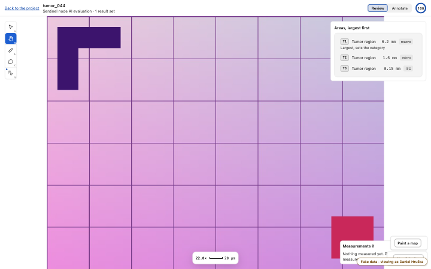
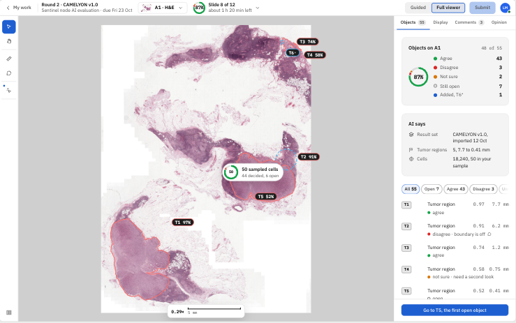
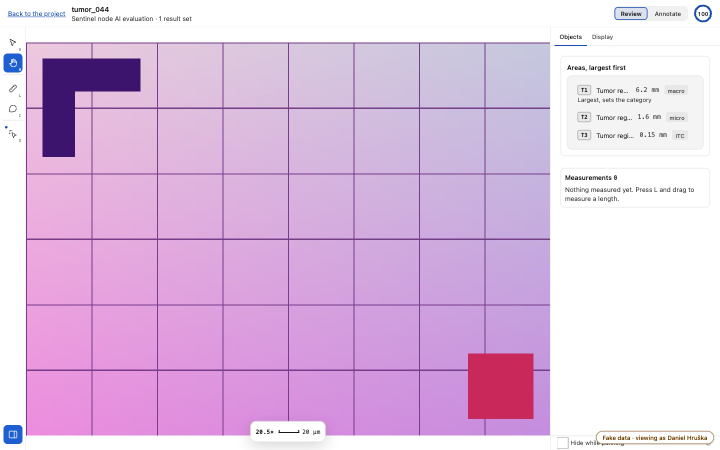
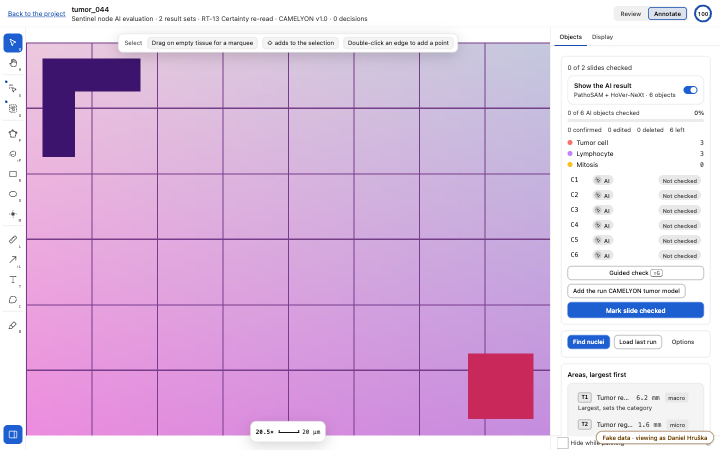

# Result: the live viewer against the frozen mock

- Date: 2026-11-17
- Backlog: PROTO-022 (the viewers match the frozen mock again)
- Kind: check
- Commit: 3d0dd477 for the inventory and the before shots, the PROTO-022 layout commits for the after shots
- Environment: MacBook, macOS 15, Chrome through Playwright, 1440x900 at scale 0.5, light theme
- Data: the fake API's sample project `00000000-0000-4000-8003-000000000007` and its fictional slide `tumor_044`, and the frozen mock's fictional demo slide. No PHI

## Question

Where do the three viewers differ from the frozen mock `docs/design/ux-mock/index.html` (screens 19 to 29), and which differences does an accepted ADR or a measured result justify? The owner asked for the mock's layout back everywhere else: one top bar with the task, slide picker and progress, a slim docked tool rail on the left, one docked inspector on the right with tabs, and nothing floating over the slide except what the mock floats.

## Method

1. Served the mock with `python3 -m http.server 7194` in `docs/design/ux-mock` and the app with `pnpm dev:fake --port 5193`.
2. Read the mock's layout helpers: `rail()`, `inspector()`, `topbar()`, the `.float` classes and the `CTX` table of the context bar. The mock docks the rail (52 px, border on the right) and the inspector (340 px, tabs Objects, Display, Comments and Opinion) under a 44 px top bar. It floats only the context bar (`.ctxbar`), the magnification bar (`.magbar`), the minimap (`.nav`), the bottom dock when the tools setting says bottom (`.dock`), the tile loading hint (`.tl-hint`), thread popovers (`.thread`), the model picker of auto region (`.picker`) and toasts. The device legend card is marked `mock-only`, so the mock never meant it to be built over the slide.
3. Read the three viewers in `apps/web`: the full viewer (`/projects/$projectId/slides/$slideId`, `screens/viewer/full-viewer.tsx`), the annotate workspace (`/projects/$projectId/slides/$slideId/annotate`, `screens/viewer-tools/annotate-view.tsx`) and the live viewer (`/projects/$projectId/slides/$slideId/live`, `viewer/slide-stage.tsx`), which the project page opens for every real slide and which also holds the Annotate workspace of real tasks.
4. Searched `docs/adr` for the floating panels, hints, tool rail, dock, legend, inspector and context bar, and `docs/results` for a measured layout result, and read the tasks that built each card with `board.py show`.
5. Shot each screen with `apps/web/e2e/mock-frame-shot.ts` (the mock's `#app` frame) and `pnpm --filter @parfocal/web shot`.

## Results

The full viewer and the annotate workspace already sit in the shared `ViewerFrame` (`screens/review/viewer-frame.tsx`), which draws the mock's top bar, docked rail and docked tabbed inspector. Their floating parts are the mock's own: magnification bar, minimap, context bar and the drawing legend of the Visualize screen. They are not changed here.

Every difference below is in the live viewer.

| # | Part | Live viewer before | Mock | Kept or restored | Reason |
|---|---|---|---|---|---|
| 1 | Tool rail | A rounded card floating at the canvas's top left | A 52 px column docked left with a border | Restored | No ADR floats it. ADR 0338 (layout experiments, rail or bottom dock) and ADR 0270 (settings schema, the `tools` setting) choose only between the left rail and the bottom dock, and both stay |
| 2 | Bottom dock of tools | Floats bottom centre when the `tools` setting or experiment says dock | Floats bottom centre when the tools setting says bottom | Kept | It is the mock's own bottom variant, and ADR 0338 runs it as an experiment arm |
| 3 | Inspector | None. Each part was its own card over the slide | One 340 px docked inspector with tabs | Restored, with the tabs Objects and Display | MEAS-003 (measurement list in the inspector) already names the inspector. The live viewer has no comments or opinion data yet, so those two tabs are left out until it does |
| 4 | Device legend (the Trackpad hint) | A card over the rail at top left | A `mock-only` card, never built over the slide | Restored into the Display tab as an inline section | ADR 0272 (input device support) requires the legend but not its place. DEV-006 (device legend on the canvas) has no ADR |
| 5 | Areas, largest first | A card at the top right | Rows in the Objects tab | Restored into the Objects tab | No ADR |
| 6 | Annotate task checks (slides checked, AI result, Mark slide checked) | A card at the top left beside the rail | The Objects tab lists what the task asks about | Restored into the Objects tab | ADR 0237 (annotate tasks on one shared layer) and ADR 0278 (blind first on annotate tasks) say what it shows, not where |
| 7 | Result sets and Layers | A card at the bottom right | The Layers list in the Display tab of the annotate screen | Restored into the Display tab | No ADR |
| 8 | Measurements | A card at the bottom right | The ruler's context bar says "Adds M1 to the Objects tab" | Restored into the Objects tab | MEAS-003 (measurement list in the inspector) |
| 9 | Count panel and Clear all | Cards at the bottom right | Counts sit in the Objects tab | Restored into the Objects tab | No ADR |
| 10 | Paint a map and Map this view | Cards at the bottom right | Display controls sit in the Display tab | Restored into the Display tab | AITUM-005 (painted maps) and AITUM-004 (view-scoped map) set behaviour, not place |
| 11 | Find nuclei, Load last run, Options and the run status | A bar at the bottom left | Model controls sit in the auto tool's context bar and picker | Restored into the Objects tab of the Annotate workspace | No ADR. The run streams over the slide as before |
| 12 | Add result set | A wide card over the slide | The upload `viewer` scene adds results from the side | Restored into the Display tab | No ADR |
| 13 | Outline display switch (fake data only) | A bar at the top centre | The Display tab | Restored into the Display tab | No ADR |
| 14 | Context bar, including the select hints | A bar at the top centre | `.ctxbar` at the top centre, text from the `CTX` table | Kept | It is the mock. ANN-003 (context bar) built it from the `CTX` table, and ADR 0255 (smart select gestures and proposals) puts the accept and discard buttons there |
| 15 | Magnification bar | Bottom centre | `.magbar` bottom centre | Kept | It is the mock |
| 16 | Tile loading hint | Above the magnification bar | `.tl-hint` above the magnification bar | Kept | It is the mock |
| 17 | Pin threads and comment popovers | Next to the pin | `.thread` next to the pin | Kept | It is the mock |
| 18 | Smart and auto tool chips (model and scale) | Small chips at the bottom | Inside the context bar | Left as they are | TODO a follow-up moves them into the context bar |
| 19 | Save status, live changes marker, edit conflict notice | Small notices at the canvas's top left and top centre | Toasts and the one banner | Kept as transient notices | They show only while something happens. No ADR covers them. TODO decide with the owner whether they join the one banner |
| 20 | Top bar | Back to the project, slide name with facts, workspace switch, viewing now and the viewed ring | My work, task and due date, slide picker, progress, Guided, Full viewer and Annotate, Submit, account | Left as it is | TODO the slide picker and the "Slide n of m" progress are a follow-up. The viewed ring already matches the mock's progress ring |
| 21 | Loading label | Top left of the canvas | | Not touched | SHELL-017 (route loading, skeletons and the viewer's loading label) owns it |

Before, the live viewer in review and in an annotate task, beside the mock's case and annotate screens:

| Live viewer before | Mock |
|---|---|
|  |  |
|  |  |

After, the same two views beside the same mock screens. The rail is a docked column, the inspector is docked on the right with Objects and Display tabs, and the only bar over the slide is the context bar and the magnification bar:

| Live viewer after | Mock |
|---|---|
|  |  |
|  |  |

The Review workspace opens the inspector on Objects, as the mock's case screen does, and the Annotate workspace opens it on Display, as the mock's annotate screen does, unless a task is open, whose checks sit in Objects. Each card stays mounted on the stage and draws into its tab through a portal (`apps/web/src/viewer/inspector-slots.tsx`), so area keys, painted maps and run streams keep working while their tab is hidden.

No ADR in `docs/adr` and no result in `docs/results` justifies a card floating over the slide. The two ADRs that could have been read that way are ADR 0138 (settings catalogue) and ADR 0195 (slide brightness as a slide layer tint), and both are only Proposed, so neither can keep a difference.

## Interpretation

The drift came from building each live feature as its own card on the stage, one task at a time, while the shared `ViewerFrame` with the mock's layout was used only by the prototype viewers. Moving the cards into one docked inspector is a change of place only. Each part stays mounted on the stage, so its keys and overlays keep working when its tab is not shown.

## Follow-ups

- TODO the top bar's slide picker and "Slide n of m" progress on the live viewer.
- TODO the smart and auto tool chips move into the context bar.
- TODO the owner decides whether the save, live changes and conflict notices join the one banner.
- The viewer goldens in `packages/golden-images` render overlay layers in their own harness and import no app code, so the layout change moves none of them and none were updated. One run passed 132, skipped 2 and failed 1, the id-labels layer over CMU-1.svs, which this change cannot reach. TODO check it on main.
- Browser specs updated for the tabs: `device-legend`, `outline-modes`, `painted-map`, `view-map`, `count-markers`, `measurement-list`, `area-nav-live` and `zoom-to-selection` select their tab first. `viewer-mock-layout.spec.ts` is new and checks the docked rail, the docked inspector and that no card sits on the stage.
