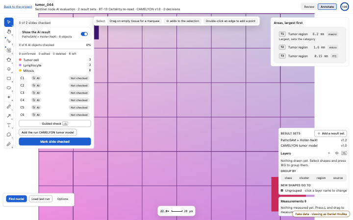
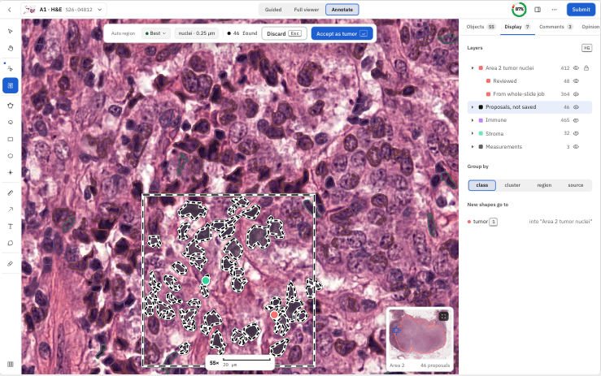
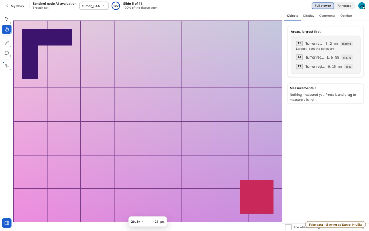

# Result: the live viewer against the frozen mock

- Date: 2026-11-17
- Backlog: PROTO-022 (the viewers match the frozen mock again), then PROTO-023 (the live viewer's top bar, tabs and hints match the frozen mock)
- Kind: check
- Commit: 3d0dd477 for the inventory and the before shots, 24c92c9b for the after shots, ea5eb481 and its follow-up on the PROTO-023 branch for the top bar, tabs and hints
- Environment: MacBook, macOS 15, Chrome through Playwright, 1440x900 at scale 0.5, light theme
- Data: the fake API's sample project `00000000-0000-4000-8003-000000000007` and its fictional slide `tumor_044`, and the frozen mock's fictional demo slide. No PHI

## Question

Where do the three viewers differ from the frozen mock `docs/design/ux-mock/index.html` (screens 19 to 29), and which differences does an accepted ADR or a measured result justify? The owner asked for the mock's layout back everywhere else: one top bar with the task, slide picker and progress, a slim docked tool rail on the left, one docked inspector on the right with tabs, and nothing floating over the slide except what the mock floats.

## Method

1. Served the mock with `python3 -m http.server 7194` in `docs/design/ux-mock` and the app with `pnpm dev:fake --port 5193`.
2. Read the mock's layout helpers: `rail()`, `inspector()`, `topbar()`, the `.float` classes and the `CTX` table of the context bar. The mock docks the rail (52 px, border on the right) and the inspector (340 px, tabs Objects, Display, Comments and Opinion) under a 44 px top bar. It floats only the context bar (`.ctxbar`), the magnification bar (`.magbar`), the minimap (`.nav`), the bottom dock when the tools setting says bottom (`.dock`), the tile loading hint (`.tl-hint`), thread popovers (`.thread`), the model picker of auto region (`.picker`) and toasts. The device legend card is marked `mock-only`, so the mock never meant it to be built over the slide.
3. Read the three viewers in `apps/web`: the full viewer (`/projects/$projectId/slides/$slideId`, `screens/viewer/full-viewer.tsx`), the annotate workspace (`/projects/$projectId/slides/$slideId/annotate`, `screens/viewer-tools/annotate-view.tsx`) and the live viewer (`/projects/$projectId/slides/$slideId/live`, `viewer/slide-stage.tsx`), which the project page opens for every real slide and which also holds the Annotate workspace of real tasks.
4. Searched `docs/adr` for the floating panels, hints, tool rail, dock, legend, inspector and context bar, and `docs/results` for a measured layout result, and read the tasks that built each card with `board.py show`.
5. Shot each screen with `apps/web/e2e/mock-frame-shot.ts` (the mock's `#app` frame) and `pnpm --filter @parfocal/web shot`.

## Results

The full viewer and the annotate workspace already sit in the shared `ViewerFrame` (`screens/review/viewer-frame.tsx`), which draws the mock's top bar, docked rail and docked tabbed inspector. This was read from the code, not compared with the mock scene by scene, and they are not changed here.

Every difference below is in the live viewer.

| # | Part | Live viewer before | Mock | Kept or restored | Reason |
|---|---|---|---|---|---|
| 1 | Tool rail | A rounded card floating at the canvas's top left | A 52 px column docked left with a border | Restored | No ADR floats it. ADR 0338 (layout experiments, rail or bottom dock) and ADR 0270 (settings schema, the `tools` setting) choose only between the left rail and the bottom dock, and both stay |
| 2 | Bottom dock of tools | Floats bottom centre when the `tools` setting or experiment says dock | Floats bottom centre when the tools setting says bottom | Kept | It is the mock's own bottom variant, and ADR 0338 runs it as an experiment arm |
| 3 | Inspector | None. Each part was its own card over the slide | One 340 px docked inspector with tabs Objects, Display, Comments and Opinion | Restored with all four tabs | PROTO-022 (the viewers match the frozen mock again) added Objects and Display. PROTO-023 (the live viewer's top bar, tabs and hints) added Comments, which lists the slide's and the task's threads, and Opinion, which holds the Slide done card of a review task and says the questions belong to a review task otherwise. The open tab is the `tab` search param, as ADR 0176 (case view state model) says, so it survives a reload, a slide switch and a workspace switch |
| 4 | Device legend (the Trackpad hint) | A card over the rail at top left | A `mock-only` card, never built over the slide | Restored into the Display tab as an inline section | ADR 0272 (input device support) requires the legend but not its place. DEV-006 (device legend on the canvas) has no ADR |
| 5 | Areas, largest first | A card at the top right | Rows in the Objects tab | Restored into the Objects tab | No ADR |
| 6 | Annotate task checks (slides checked, AI result, Mark slide checked) | A card at the top left beside the rail | The Objects tab lists what the task asks about | Restored into the Objects tab | ADR 0237 (annotate tasks on one shared layer) and ADR 0278 (blind first on annotate tasks) say what it shows, not where |
| 7 | Result sets and Layers | A card at the bottom right | The Layers list in the Display tab of the annotate screen | Restored into the Display tab | No ADR |
| 8 | Measurements | A card at the bottom right | The ruler's context bar says "Adds M1 to the Objects tab" | Restored into the Objects tab | MEAS-003 (measurement list in the inspector) |
| 9 | Count panel and Clear all | Cards at the bottom right | Counts sit in the Objects tab | Restored into the Objects tab | No ADR |
| 10 | Paint a map and Map this view | Cards at the bottom right | Display controls sit in the Display tab | Restored into the Display tab | AITUM-005 (painted maps) and AITUM-004 (view-scoped map) set behaviour, not place |
| 11 | Find nuclei, Load last run, Options and the run status | A bar at the bottom left | Model controls sit in the auto tool's context bar and picker | Restored into the Objects tab of the Annotate workspace | No ADR. The run streams over the slide as before |
| 12 | Add result set | A wide card over the slide | Not read in the mock for this check | Restored into the Display tab beside the result sets | No ADR |
| 13 | Outline display switch (fake data only) | A bar at the top centre | The Display tab | Restored into the Display tab | No ADR |
| 14a | Context bar with tool options, accept and discard | A bar at the top centre | `.ctxbar` at the top centre on the annotate screen | Kept | It is the mock, and ADR 0255 (smart select gestures and proposals) puts the accept and discard buttons there |
| 14b | Hint-only bar of a tool, such as the select hints | A bar at the top centre | `ctxBar()` draws it as `mock-only`, "Mock only · tool hints", so it was never meant to be built | Restored | The bar now draws only when the tool has options (the class strip), proposals are waiting, or the tool's hints have never been shown on this device. A hint-only tool such as Select, Ruler, Arrow, Text or Comment shows its hints once, the first time it is picked, and never again (`annotations/hints-once.ts`) |
| 15 | Magnification bar | Bottom centre | `.magbar` bottom centre | Kept | It is the mock |
| 16 | Tile loading hint | Above the magnification bar | `.tl-hint` above the magnification bar | Kept | It is the mock |
| 17 | Pin threads and comment popovers | Next to the pin | `.thread` next to the pin | Kept | It is the mock |
| 18 | Smart and auto tool chips (model and scale) | Small chips at the bottom | Inside the context bar | Restored | The hover preview switch, the Outlining status and the auto region's tile progress portal into the context bar (`annotations/context-extras.tsx`), so nothing sits at the bottom of the slide |
| 19 | Save status, live changes marker, edit conflict notice | Small notices at the canvas's top left and top centre | Toasts and the one banner | Restored as the mock shows | The save status is a quiet word in the top bar, and the live changes marker and the conflict notice sit in the one banner under the top bar (`viewer/stage-notices.tsx`). This is option A of question 144 in `docs/decisions.md` (where the save, live changes and conflict notices go), built without waiting for the answer as the lead asked. Option B would move them back onto the slide |
| 20 | Top bar | Back to the project, slide name with facts, workspace switch, viewing now and the viewed ring | My work, task and due date, slide picker, progress, Guided, Full viewer and Annotate, Submit, account | Restored | `viewer/live-top-bar.tsx` draws My work, the task or project with its facts and due date, the slide picker over the task's, the case's or the project's slides, the viewed ring with "Slide n of m", the Guided (review tasks only), Full viewer and Annotate switch, Submit (review tasks only, opening the Opinion tab), viewing now and the account menu. The remote tag and Copy into Parfocal stay beside the progress, as ADR 0383 (remote slides served from cached byte ranges) puts them in the live viewer. "Slide n of m" comes from the slide neighbours call for a task or the project, and from the case's slides for a case. Q and E step to the previous and next slide from the shortcut registry, "Slide n of m" opens the progress popover in a task, Open report takes the place of Submit in a clinical project, and Go to on a comment thread flies the camera to its area, cell parent, pin or shape |
| 21 | Loading label | Top left of the canvas | | Kept | SHELL-017 (route loading, skeletons and the viewer's loading label) owns it, and it shows only until the first frame |

Before, the live viewer in review and in an annotate task, beside the mock's case and annotate screens:

| Live viewer before | Mock |
|---|---|
|  |  |
|  |  |

After, the same two views beside the same mock screens. The rail is a docked column, the inspector is docked on the right with Objects and Display tabs, and the only bar over the slide is the context bar and the magnification bar:

| Live viewer after | Mock |
|---|---|
|  |  |
|  |  |

The Review workspace opens the inspector on Objects, as the mock's case screen does, and the Annotate workspace opens it on Display, as the mock's annotate screen does, unless a task is open, whose checks sit in Objects. Each card stays mounted on the stage and draws into its tab through a portal (`apps/web/src/viewer/inspector-slots.tsx`), so area keys, painted maps and run streams keep working while their tab is hidden.

No ADR in `docs/adr` and no result in `docs/results` justifies a card floating over the slide. The two ADRs that could have been read that way are ADR 0138 (settings catalogue) and ADR 0195 (slide brightness as a slide layer tint), and both are only Proposed, so neither can keep a difference.

## Interpretation

The drift came from building each live feature as its own card on the stage, one task at a time, while the shared `ViewerFrame` with the mock's layout was used only by the prototype viewers. Moving the cards into one docked inspector is a change of place only. Each part stays mounted on the stage, so its keys and overlays keep working when its tab is not shown.

After PROTO-023, the live viewer in review at 1440x900 and scale 0.5. It differs from the PROTO-022 after shot on 6.7% of pixels with a mean error of 5.6. The diff image was not inspected:

## Follow-ups

- Done in PROTO-023 (the live viewer's top bar, tabs and hints match the frozen mock): the top bar's slide picker and "Slide n of m" progress, the smart and auto chips in the context bar, the notices in the top bar and the one banner, the hint-only bar shown once, the inspector tab in the `tab` search param, Comments and Opinion tabs, "Hide while panning" hiding the inspector while the camera moves under a held pointer, and the panel key toggling the inspector. A click that does not move the camera, such as a marquee in Annotate, leaves the inspector in place.
- TODO the owner answers question 144 in `docs/decisions.md` (where the save, live changes and conflict notices go). The build follows option A, so option B would move them back.
- The Comments tab lists threads but has no Go to, because the live viewer finds pins on the slide itself through the comment tool.
- A slide opened from the project page lands in the Annotate workspace, so Areas, Measurements and Find nuclei start behind the Objects tab there.
- About 40 other specs that open the live viewer were not run in either change.
- The viewer goldens in `packages/golden-images` render overlay layers in their own harness and import no app code, so neither layout change moves them. PROTO-022 saw one run pass 132, skip 2 and fail 1, the id-labels layer over CMU-1.svs. PROTO-023's run with one worker gave the same, with 19 tests not run after that failure. TODO check it on main.
- Browser specs: PROTO-022 updated `device-legend`, `outline-modes`, `painted-map`, `view-map`, `count-markers`, `measurement-list`, `area-nav-live` and `zoom-to-selection` and added `viewer-mock-layout.spec.ts`. PROTO-023 added three tests to `viewer-mock-layout.spec.ts` (picker, progress, four tabs kept across a reload and a workspace switch, hide while panning, the save status and chips placement), renamed the Review choice to Full viewer in `workspaces.spec.ts` and checked in `context-bar.spec.ts` that a hint-only bar shows once.
