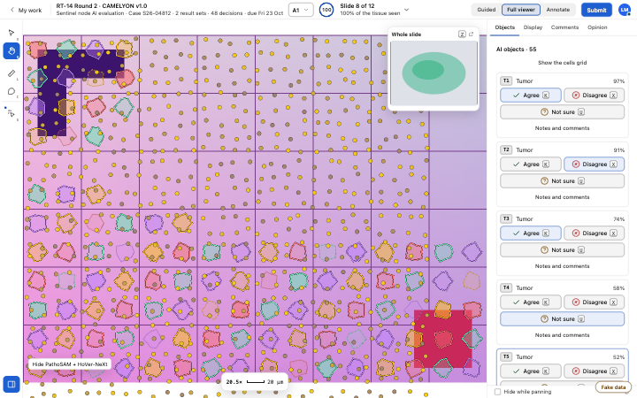
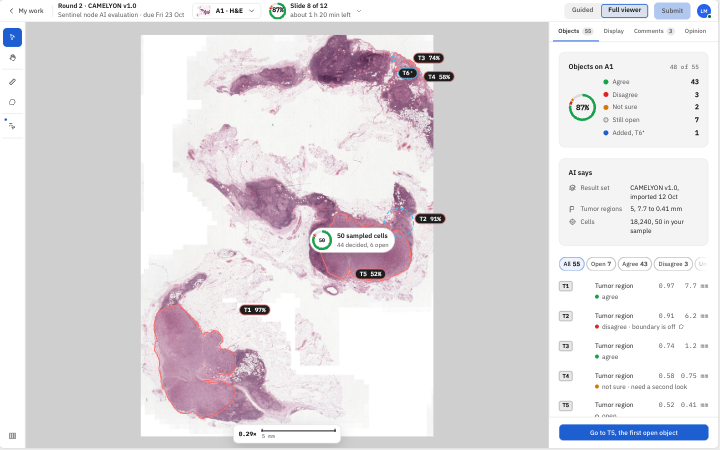
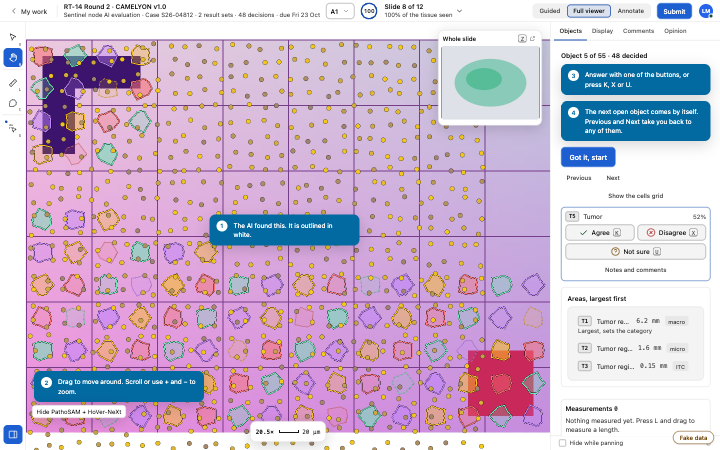
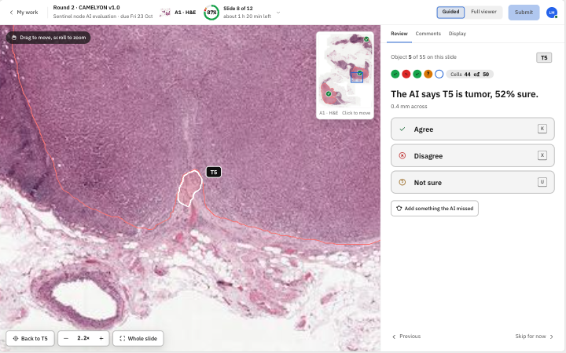
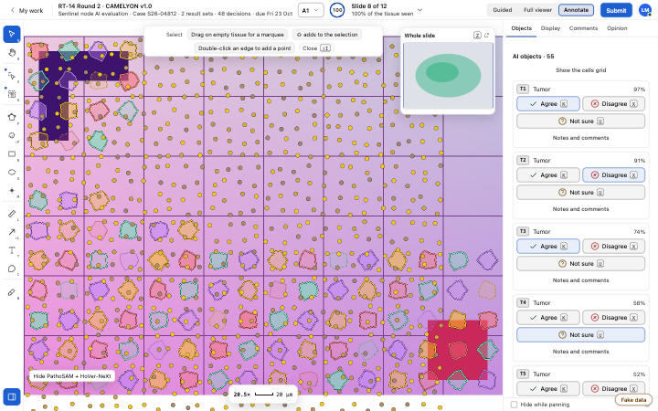
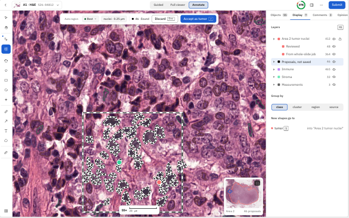

# Result: how far the viewer has drifted from the frozen mock

- Date: 2026-11-18
- Backlog: asked by the owner on 2026-11-18, committed under PROTO-030 (the run's audit slot). Follows PROTO-022 (the viewers match the frozen mock again) and PROTO-023 (the live viewer's top bar, tabs and hints match the frozen mock)
- Kind: check
- Commit: 0bac7dcc (the branch point of this audit)
- Environment: MacBook, macOS 15, Chrome through Playwright, 1440x900 at scale 0.5, light theme. The Mac was under load from other agents (load average 30 to 50), so nothing here is a timing
- Data: the fake API (`pnpm --filter @parfocal/web dev:fake`), project `00000000-0000-4000-8003-000000000007`, slide A1 `…8005-000000000001`, review task RT-14 `…8007-000000000014`, annotate task `…8007-000000000021`, viewed as Lenka Malá (`as=LM`). The mock's own fictional demo slide. No PHI

## Question

The owner, 2026-11-18: "the real app somehow deviated too much from the mock in the viewer mostly, I don't like that, we need to get back on track, find all differences." Where does every viewer screen of the running app differ from the frozen mock `docs/design/ux-mock/index.html` (screens `case`, `findings`, `navigator`, `measure`, `gallery`, `annotate`, `comments`, `focus`, `peek`, `layers` and `guided`), how big is each fix, and does an accepted ADR justify keeping any of them?

## Method

1. Served the mock with `python3 -m http.server 7197` and the app with the fake API on port 5197.
2. A Playwright script opened each mock scene and each app address and wrote an outline of every visible control and text with its place, size, label, state and font. 33 mock outlines and 25 app outlines were read side by side. Clicks and keys were sent for the tabs, the three top bar popovers, the tools V, L, C, S and U, one object row, "Notes and comments" and the cells grid.
3. `pnpm --filter @parfocal/web shot APP_URL out.png --against MOCK.png` gave the share of differing pixels for three pairs. Two images were opened, the app's full viewer and the mock's case screen.
4. The engine viewer's source (`apps/web/src/viewer`) and the prototype screens (`apps/web/src/screens/review`, `apps/web/src/screens/viewer`) were searched for the mock's texts to see which parts exist only in the prototype.
5. `docs/adr` was searched for each part. Only an Accepted ADR counts as a reason to keep a difference.

Not compared: the bottom dock of tools, compare slides, the whole slide peek overlay, the shortcuts sheet, the developer drawer, dark theme, and anything that needs a drag on the slide. The issue states were read from the mock and searched for in the app's code, not triggered in the app.

## Results

### Why it drifted

ADR 0398 (every viewer screen draws the slide through one engine stage) moved the full viewer, guided review, annotate and the annotate task onto `viewer/engine-viewer.tsx`. It asks for "the mock's frame around it" and says the prototype only parts "are not on the engine viewer until a task brings them over". The frame came over. The contents of the panels did not. The mock's Objects panel, object card, guided panel, slides popover, issue notices and Display panel still exist as React components in `screens/review` and `screens/viewer`, and are drawn only when the address carries a prototype `scene`. So most fixes below are a port of an existing component onto the stage's data, not new design.

PROTO-022 and PROTO-023 compared only the frame of the live viewer (rail, inspector, top bar, tabs). Those parts still hold: the live review screen differs from the PROTO-023 after shot on 8.8% of pixels with a mean error of 5.6.

### Numbers

| Pair | Differing pixels | Mean error | Note |
|---|---|---|---|
| App full viewer in task RT-14 against mock `case` | 71.9% | 38.9 | The slide picture itself differs, so the number is an upper bound |
| App guided review against mock `guided` | 73.7% | 49.8 | Same |
| App annotate workspace against mock `annotate` | 71.7% | 54.0 | Same |
| App live review against the PROTO-023 after shot | 8.8% | 5.6 | The frame has not moved since 2026-11-17 |

| App | Mock |
|---|---|
|  |  |
|  |  |
|  |  |

### Differences

62 differences. Places are in pixels of the 1440x900 frame. "None" in the last column means no accepted ADR justifies keeping the difference.

#### Group A. Objects tab of the full viewer (proposed task PROTO-D1)

| # | Where | Mock | App | Size | ADR that keeps it |
|---|---|---|---|---|---|
| 1 | Objects tab, head | A card "Objects on A1" with "48 of 55", a 56 px decision ring at 87% and the counts Agree 43, Disagree 3, Not sure 2, Still open 7, Added 1 | One line "AI objects · 55" | S | None |
| 2 | Objects tab, "AI says" | A card with Result set "CAMELYON v1.0, imported 12 Oct", Tumor regions "5, 7.7 to 0.41 mm" and Cells "18,240, 50 in your sample" | Missing | S | None |
| 3 | Objects tab, filter | Chips All 55, Open 7, Agree 43, Disagree 3, Unsure 2, Added 1 | Missing | S | None |
| 4 | Objects tab, rows | A 58 px row per object: ID, "Tumor region", score 0.97, size 7.7 mm and a second line with the decision and its note | A 148 px card per object with "Tumor", "97%", three answer buttons and "Notes and comments". No size, no note line. The list is 8,634 px tall for 55 objects | M | None |
| 5 | Objects tab, cells | One row "Cells, 50 sampled · 44 of 50 decided" with "Show the cells" | All 50 sampled cells are listed as cards after the five regions, with a "Show the cells grid" button above the list | S | None |
| 6 | Objects tab, foot | A primary button "Go to T5, the first open object" | Missing | S | None |
| 7 | Selected object | A card docked at the foot of the panel: ID, "Tumor region · 0.41 mm", Close, "The AI says T5 is tumor, 52% sure." and three stacked 38 px buttons Agree K, Disagree X, Not sure U | A click on a row, and `object=T5` in the address, change nothing in the panel. The buttons sit on every card, 32 px, two in a row and one below | M | None |
| 8 | A measurement | The ruler adds M1 to the object list, and selecting it shows "Measurement · 8.00 mm" with "Remove M1" | A "Measurements" card and an "Areas, largest first" card below the whole object list, out of sight | S | None. MEAS-003 (measurement list in the inspector) sets no place |
| 9 | Cells panel over the slide | Tiles are 40 px crops of each cell, and picking one flies to it at about 89x with the cell's card in the panel | Tiles are text ("T1·C101 tumor 35%"), the camera stays and no card opens | M | None |

#### Group B. Frame details (proposed task PROTO-D2)

| # | Where | Mock | App | Size | ADR that keeps it |
|---|---|---|---|---|---|
| 10 | Inspector tabs | Counts on the tabs: "Objects 55", "Comments 3" | No counts | S | None |
| 11 | Inspector look | A grey panel with white cards | A white panel with outlined cards | S | None |
| 12 | Inspector foot | Nothing. "Panel while moving" is a Layout setting | A "Hide while panning" checkbox and a pop-out button in a 29 px foot | S | None. Overlaps PROTO-031 (every Settings row does what it says) |
| 13 | Rail foot | "Compare slides" | "Hide the side panel", drawn pressed. Compare is missing from the rail | S | None |
| 14 | Tool on open | Select (V) is active in review | Pan (H) is active | S | None |
| 15 | Magnification bar | 216x38 at the bottom centre, radius 10, steps "1.25×" to "40×" | 151x42, radius 12, first step "1.3×" | S | None |
| 16 | Hint bars | Marked "Mock only · tool hints", one line of pills | Two and three line bars up to 524x96 (smart select) with "Close ⇧I" | S | None. PROTO-032 (tool hint bars close and show once) already covers closing. Only the height is new |

#### Group C. What is drawn on the slide (proposed task PROTO-D3)

| # | Where | Mock | App | Size | ADR that keeps it |
|---|---|---|---|---|---|
| 17 | Region tags | Each region carries a tag with its ID and score, such as "T1 97%" | No tags seen on slide A1 of the fake API. ADR 0398 draws an object only when it has an outline in slide pixels, so check on a slide whose regions have outlines | S | ADR 0398 for objects without an outline only |
| 18 | Cells at low power | One chip "50 sampled cells · 44 decided, 6 open" with a ring. A click zooms to them | Every cell of the result set is drawn as a dot or outline over the whole slide, and there is no chip | M | None. ADR 0399 (cells draw as dots while a software renderer moves) is about speed only |
| 19 | "Whole slide" button | A 131x40 button at the bottom left of the slide once the view is on an object | Missing. Only the Z key and the minimap | S | None |
| 20 | Result set chip | Nothing on the slide. Result sets are in the Display tab and the slides popover | A chip "Hide PathoSAM + HoVer-NeXt" floats at the bottom left of the slide on every viewer screen | S | None. The 2026-11-17 parity result found no ADR that floats a card over the slide |
| 21 | Going to an object | Selecting an object flies the camera to it and marks its tag | Nothing visible happens on a row click | S | None |

#### Group D. Minimap (proposed task PROTO-D4)

| # | Where | Mock | App | Size | ADR that keeps it |
|---|---|---|---|---|---|
| 22 | When it shows | Hidden while most of the tissue is on screen | Shown with the whole slide on screen | S | None. ADR 0185 (smart minimap state machine and placement) says hidden, so the app also breaks the ADR |
| 23 | Where it sits | Bottom right by preference (905, 594) | Top right (876, 60) on every screen, and top right in focus mode where the mock has bottom left | S | None. ADR 0185 prefers bottom right |
| 24 | Its text | Head "Whole slide · 21% seen" or "· 3 threads", foot "T2 of 5" and "10× · 1 of 5 decided". In annotate the foot is "Area 2" and "46 proposals" | Head "Whole slide" only, no foot | S | None |
| 25 | In guided review | A small inset "A1 · H&E · Click to move" | The same "Whole slide" card as elsewhere | S | None |

PROTO-034 (cell review follows the Minimap setting with a movable smart minimap) touches the same component. Do PROTO-D4 in the same change or straight after it.

#### Group E. Top bar and its popovers (proposed tasks PROTO-D5 and PROTO-D6)

| # | Where | Mock | App | Size | ADR that keeps it |
|---|---|---|---|---|---|
| 26 | Title | "Round 2 · CAMELYON v1.0" over "Sentinel node AI evaluation · due Fri 23 Oct" (253 px) | "RT-14 Round 2 · CAMELYON v1.0" over "Sentinel node AI evaluation · Case S26-04812 · 2 result sets · 48 decisions · due Fri 23 Oct" (513 px), which pushes the slide chip from x 386 to x 652 | S | None |
| 27 | Slide chip | A thumbnail and "A1 · H&E", 138 px | "A1", 57 px, no stain and no thumbnail | S | None |
| 28 | Progress ring | The decision ring, 87%, in agree, disagree and unsure colours, with "about 1 h 20 min left" | A blue tissue seen ring "100" with "100% of the tissue seen" | S | None. ADR 0234 (coverage is a per-person bitset) is only Proposed |
| 29 | Workspace switch | Guided and Full viewer on review screens | Guided, Full viewer and Annotate on every screen | S | None |
| 30 | Workspace switch in guided | Guided is checked | Full viewer is checked on `/tasks/…/guided` | S | None. Overlaps PROTO-033 (the Guided button works) |
| 31 | Submit | Disabled while anything is open, with the reason "7 objects and 2 questions are still open." | Always enabled, opens the Opinion tab | S | None |
| 32 | Back button tooltip | "Back to My work. Every answer is saved" | "Back to My work. Every edit is saved" | S | None |
| 33 | Progress popover | A row "Added, T6⁺", and the ring shows 87% with 7 open | No Added row. The popover says "48 of 48", 0 open and 100% done while the Opinion tab says "7 left" and "48 of 55" | S | None |
| 34 | Account menu | A "Parfocal home" row | No home row, and an extra "Send feedback" row | S | None |
| 35 | Slides popover, head | "Case S26-04812", the specimen and project, and "Open the case" | Missing | S | None |
| 36 | Slides popover, rows | Thumbnail, "A1 · H&E", the result set names, a result set count, a status pill, a progress bar for a slide still building, and Q and E key caps | "A1", a count and a pill | S | None |
| 37 | Slides popover, groups | "Slides in this case" and "Loose slides in task RT-14" | One list "Slides in this task" | S | None |
| 38 | Slides popover, foot | "Result sets of A1", "Compare", "Add slides" | Missing. The popover is 460x170 where the mock's is 460x530 | S | None |

The mock's annotate screen still draws an older top bar (an icon back button, a ring without text, "Hide the side panel" and "More" icons). PROTO-023 chose the case screen's top bar for every workspace, so that is not counted as a difference.

#### Group F. Guided review (proposed tasks PROTO-D7 and PROTO-D8)

In the app, guided review is the full viewer with one card in the Objects tab. In the mock it is its own calmer layout.

| # | Where | Mock | App | Size | ADR that keeps it |
|---|---|---|---|---|---|
| 39 | Tool rail | None | The five review tools | S | None |
| 40 | Top bar | 64 px tall with 40 px controls | 44 px | S | None |
| 41 | Panel | 469 px wide with the tabs Review, Comments, Display | 340 px with Objects, Display, Comments, Opinion | M | None |
| 42 | Object strip | "Object 5 of 55 on this slide" and a row of 22 px dots, one per region with its state, then a chip "Cells 44 of 50" | "Object 5 of 55 · 48 decided" | S | None |
| 43 | The question | A heading "The AI says T5 is tumor, 52% sure." and "0.4 mm across" | A row "T5 Tumor 52%" | S | None |
| 44 | Answer buttons | Three stacked buttons, 417x58 each | 138x32, two in a row and one below | S | None |
| 45 | Adding an object | "Add something the AI missed" | Missing | S | None |
| 46 | Panel foot | "Previous" on the left and "Skip for now" on the right | "Previous" and "Next" under the heading | S | None |
| 47 | Slide done | A "Slide 8 is done" card with the questions in the Review tab | The questions are in the Opinion tab | S | None |
| 48 | Slide chip | Read only, "Slide 8 of 12. Submit opens the next one" | The slide picker | S | None |
| 49 | Stage controls | "Back to T5", a zoom group with minus, "2.2×" and plus, and a "Whole slide" toggle at the bottom left. No magnification bar | The magnification bar and none of the three | M | None |
| 50 | Pan hint | A chip "Drag to move, scroll to zoom" at the top left | Missing after the first run | S | None |
| 51 | First run tips | Four numbered tips, the third beside the answer buttons | Tips 3 and 4 and "Got it, start" replace the top of the panel | S | ADR 0277 (guided tour and help) sets the tips, not their place |

PROTO-033 (the review panel's buttons are visible and Guided works) is in progress and changes the same card. Start PROTO-D7 after it merges.

#### Group G. Display tab (proposed task PROTO-D9)

| # | Where | Mock | App | Size | ADR that keeps it |
|---|---|---|---|---|---|
| 52 | Preset | A "Preset" select on "Task default" | Missing | S | None. ADR 0132 (display settings, presets and task locks) is only Proposed |
| 53 | How objects draw | Draw as Outline, Fill or Dots. Width 1, 2 or 3 px. Opacity. Color by Class, Score or Decision. An "ID labels" switch | One switch "Fade, Mark unsure, Bands" | M | None |
| 54 | What the AI shows | Confidence as Number, Word, Color or Hidden. Heatmap. Score cutoff with "Objects under it draw dashed and faint". The result sets | Missing in the review workspace. Result sets show only in the annotate workspace | M | None |
| 55 | Extra buttons | None | "Map this view" and "Paint a map" | S | None. PROTO-033 renames them |

PROTO-031 (every Settings row draws, explains and previews what it really does) promised to add the missing display settings to the Display tab. The viewer's tab still has only the rows above.

#### Group H. Comments, notes and the Opinion tab (proposed task PROTO-D10)

| # | Where | Mock | App | Size | ADR that keeps it |
|---|---|---|---|---|---|
| 56 | Comments tab | A second section "Your decision notes" with every note on the slide | No such section. A note shows only after "Notes and comments" on one object | S | ADR 0285 (a decision note stays on the decision and shows in the Comments tab) keeps the per object entry, not the missing list |
| 57 | Comments tab | "New comment on an ID C" | "New comment C", and an extra Open and Resolved switch | S | None |
| 58 | A thread | A 340x427 popover beside the pin on the slide, with the list still in the tab | "Notes and comments" replaces the Comments tab with the object's thread | S | None |
| 59 | Opinion tab, checklist | One row "6 cells in the sample are still open · Go to the cells" | One row per open cell, seven rows for slide A1 | S | None |

#### Group I. Annotate workspace (proposed task PROTO-D11)

| # | Where | Mock | App | Size | ADR that keeps it |
|---|---|---|---|---|---|
| 60 | Tab on open | Display, with the layer tree | Objects, with the review list, when a task is open | S | None |
| 61 | Auto region bar | "Auto region", a tier pill "Best", "nuclei · 0.25 µm", "Discard Esc" and "Accept as tumor ↵" | "Auto region" and four class swatches | S | ADR 0255 (smart select gestures and proposals) puts accept and discard in the bar. Overlaps PROTO-036 (one-click annotation has its model picker) |

The tool rail of both workspaces matches the mock tool for tool and key for key. The Layers, Group by and New shapes go to blocks are there.

#### Group J. Issue states (proposed task PROTO-D12)

| # | Where | Mock | App | Size | ADR that keeps it |
|---|---|---|---|---|---|
| 62 | No results, slide cannot be read, task withdrawn, signed off, AI still reading | A card on the slide with two actions ("Next slide" and "Ask the researcher", "Retry", "Back to My work"), a read only banner "Signed off 15 Oct. Changes need an amendment." and, while the AI runs, a panel "Still reading this slide, 2 regions so far" with a "Tell me when it is ready" switch | The texts exist only in `screens/viewer/viewer-notices.tsx`, `screens/viewer/objects-panel.tsx` and `screens/review/guided-review.tsx`, which the engine viewer does not draw. The tile hints ("Loading the slide", "Loading sharper tiles", "Slow source") are on the stage | M | None. PROTO-028 (the live viewer's one banner) owns the banner's place |

### What matches

The 44 px top bar with My work, title, slide chip, progress, switch, Submit and account. The 52 px docked rail with the mock's tools in the mock's order. The 340 px docked inspector with the tabs Objects, Display, Comments, Opinion and its resize edge. The Opinion tab's ring, summary and four questions. The progress popover's layout. The Comments tab's thread list. The cells panel's frame, title, "Agree with the rest" and key legend. Focus mode's object card and key hints. The context bar's place.

## Interpretation

The frame is right and the insides are not. The reviewer's main loop in the mock is: see the summary, filter to open, pick a row, read one sentence, press one of three big buttons, go to the next. In the app the same tab is 55 identical cards with nine buttons on screen at once and no summary, filter or "go to the first open" button. Guided review, which the mock draws as a separate calm screen, is that same list with a different heading.

Every part in groups A, E (popover), F, G and J already exists as a React component built from the mock in the prototype screens. The work is to feed those components from the stage's review objects in place of the prototype fixtures, and to delete the stand-in cards in `viewer/stage-review-objects.tsx`.

No accepted ADR justifies any of the 62 differences. ADR 0398 partly explains row 17. ADR 0185 is broken by rows 22 and 23.

## Proposed backlog tasks

IDs are placeholders for the lead to number. Order is by how much of the owner's complaint each one removes.

**PROTO-D1 · The Objects tab shows the mock's summary, filters, compact rows and one object card**

The engine viewer's Objects tab lists every review object as a 148 px card with its own three buttons, 8,634 px for 55 objects, and has no summary, no filter and no way to the first open object (rows 1 to 9 of the 2026-11-18 drift result). The mock's panel exists as `screens/viewer/objects-panel.tsx` and `screens/review/object-card.tsx` but is drawn only in prototype scenes.
Draw the mock's Objects panel on the engine stage from the task's review objects: the "Objects on A1" card with the decision ring and counts, the "AI says" card, the filter chips, 58 px rows with ID, kind, score, size and the decision line, one "Cells, 50 sampled" row, measurements as rows, and "Go to T5, the first open object". Selecting a row flies to the object and docks one object card at the foot with the sentence "The AI says T5 is tumor, 52% sure." and three stacked answer buttons. Picking a cell in the cells panel does the same for the cell and shows its crop.
Done when a browser test on the fake task RT-14 finds the summary counts, filters to Open and sees 7 rows, clicks T5, sees the camera move and the card, decides it with K and sees the row and the ring change, and the list for 55 objects is under 900 px tall before scrolling.
Depends on PROTO-033. Size: M.

**PROTO-D2 · The viewer frame's small parts match the mock**

The frame from PROTO-022 holds, but seven details differ (rows 10 to 16): the tabs carry no counts, the panel is white where the mock is grey with white cards, the panel has a foot with "Hide while panning" and a pop-out button, the rail's foot holds "Hide the side panel" where the mock has "Compare slides", the viewer opens on Pan where the mock opens on Select, the magnification bar is 151x42 with "1.3×" where the mock is 216x38 with "1.25×", and hint bars wrap to three lines.
Add the counts, use the mock's panel colours, leave "Hide while panning" to the Layout setting and drop the panel's foot, put Compare slides at the rail's foot, open review on Select, match the magnification bar's size and labels, and keep a hint bar to one line.
Done when a browser test reads "Objects 55" and "Comments 3" on the tabs, finds Compare slides in the rail and Select pressed on open, and a `shot --against` of the inspector and the magnification bar compares by number against new baselines.
Size: S.

**PROTO-D3 · The slide shows region tags, one chip for the sampled cells and a Whole slide button, and nothing else floats**

On the slide the mock draws each region's outline with a tag such as "T1 97%", one chip "50 sampled cells · 44 decided, 6 open" at low power, and a "Whole slide" button once the view is on an object. The app draws every cell of the result set over the whole slide, shows no chip, no tags on the fake slide and no button, and floats a "Hide PathoSAM + HoVer-NeXt" chip at the bottom left (rows 17 to 21).
In a review task draw the regions with their tags and only the sampled cells, collapse the sample into the mock's chip while the cells are under about 7 px, add the "Whole slide" button, and move the result set switch into the Display tab. Outside a task a whole result set keeps drawing as VIEW-076 (every cell of a result set draws on the engine stage) built it.
Done when a browser test on RT-14 sees five tags and one chip at whole slide zoom, clicks the chip and lands on the cells, clicks "Whole slide" and is back, finds no result set chip over the slide, and the viewer golden images pass.
Size: M.

**PROTO-D4 · The minimap hides, sits and labels itself as the mock and ADR 0185 say**

The minimap shows at the top right of every viewer screen, also while the whole slide is on screen, with the head "Whole slide" and no foot (rows 22 to 25). The mock and ADR 0185 (smart minimap state machine and placement) hide it while most of the tissue is on screen, prefer the bottom right corner, and give it a head such as "Whole slide · 21% seen" and a foot such as "T2 of 5" and "10× · 1 of 5 decided". Guided review has a small inset "Click to move".
Wire the stage's minimap to the NAV-006 (smart minimap state machine) states and the NAV-007 (minimap placement scoring) corners, and add the head and foot texts and the guided inset.
Done when a browser test sees no minimap at whole slide zoom under When useful, sees it at the bottom right after zooming in, reads the head and foot texts in a task, and sees the inset in guided review.
Depends on PROTO-034. Size: S.

**PROTO-D5 · The top bar's title, slide chip, decision ring and Submit match the mock**

The top bar's parts are in the mock's order, but the title is 513 px wide with the task number, case, result set count and decision count, the slide chip is "A1" without stain or thumbnail, the ring shows tissue seen where the mock shows decisions, the switch offers Annotate on review screens and checks Full viewer in guided review, Submit is always enabled, and the progress popover counts 48 of 48 while the Opinion tab counts 48 of 55 (rows 26 to 34).
Shorten the title to the task name over project and due date, draw the chip as thumbnail and "A1 · H&E", show the decision ring with the time left and keep tissue seen inside the progress popover, disable Submit with the mock's reason while objects or required questions are open, fix the checked choice in guided review, make the popover count the same objects as the Opinion tab with its Added row, and add "Parfocal home" to the account menu.
Done when a browser test on RT-14 reads "A1 · H&E", "87%" and a disabled Submit whose reason names 7 objects, decides the open objects and sees Submit enabled, and reads the same counts in the popover and the Opinion tab.
Size: S.

**PROTO-D6 · The slides popover shows the case, loose slides and its three actions**

The slides popover lists two slides with a count and a pill. The mock's popover has a case head with "Open the case", the groups "Slides in this case" and "Loose slides in task RT-14", rows with thumbnail, stain, result set names, a build progress bar and status, the Q and E key caps, and the actions "Result sets of A1", "Compare" and "Add slides" (rows 35 to 38). The mock's version exists in `screens/review/review-top-popovers.tsx`.
Draw that popover on the engine viewer from the task's and the case's slides, and wire its three actions to the Display tab, compare and the upload flow.
Done when a browser test opens the popover on RT-14, reads the case head, both groups and the three actions, opens a loose slide from it, and steps with Q and E.
Size: S.

**PROTO-D7 · Guided review has the mock's own panel**

Guided review in the app is the full viewer with one card in the Objects tab, the tool rail and four tabs (rows 39 to 48). The mock's guided screen has no rail, a taller top bar, a 469 px panel with the tabs Review, Comments and Display, a strip of dots for the objects with a "Cells 44 of 50" chip, the question as a heading, three 58 px answer buttons, "Add something the AI missed", "Previous" and "Skip for now", and the slide done card in the Review tab. It exists as `screens/review/guided-review.tsx` on prototype data.
Draw that layout on the engine stage for `/tasks/$taskId/guided`, fed by the stage's review objects and decisions, with decision notes and the cells panel as ADR 0398 (one engine stage) lists them.
Done when a browser test opens guided review on RT-14, finds no tool rail, reads the heading for T5, answers with K, sees the next open object and its dot change, skips one, goes back with Previous, finishes the slide and sees "Slide 8 is done" in the Review tab.
Depends on PROTO-033. Size: M.

**PROTO-D8 · Guided review has its own stage controls**

On the slide the mock's guided review shows "Back to T5", a zoom group with minus, the magnification and plus, a "Whole slide" toggle, a pan hint chip and the first run tips beside what they explain, and no magnification bar (rows 49 to 51). The app shows the full viewer's magnification bar and puts tips 3 and 4 in the panel.
Add the three controls at the bottom left of the guided stage, hide the magnification bar there, show the pan hint, and place each tip beside its target.
Done when a browser test pans away, clicks "Back to T5" and is centred on T5 again, zooms with plus and minus and reads the new magnification, toggles "Whole slide", and a first run shows four tips each next to its control.
Depends on PROTO-D7. Size: S.

**PROTO-D9 · The viewer's Display tab has the mock's preset and groups**

The Display tab in a review task holds one switch (Fade, Mark unsure, Bands) and the buttons "Map this view" and "Paint a map". The mock's tab has a Preset select, "How objects draw" (Draw as, Width, Opacity, Color by, ID labels) and "What the AI shows" (Confidence, Heatmap, Score cutoff, Result sets) (rows 52 to 55). ADR 0268 (how display state reaches the overlay system) is the accepted path for these values. It was not read for this audit.
Draw the mock's groups in the stage's Display tab, bind each control to the display state the overlays read, keep the two map buttons under "What the AI shows", and show the result sets in both workspaces. Record in `docs/decisions.md` any control whose behaviour ADR 0132 (display settings, presets and task locks, Proposed) leaves open.
Done when a browser test switches Draw as to Dots and Fill, changes width and opacity, colours by decision, hides ID labels, moves the score cutoff and sees each change in the overlay's reported state, and the viewer golden images pass.
Size: M.

**PROTO-D10 · Comments, decision notes and the Opinion checklist read as in the mock**

The Comments tab has no "Your decision notes" list, its button says "New comment" where the mock says "New comment on an ID", "Notes and comments" replaces the whole tab where the mock opens a thread beside its pin, and the Opinion tab's "Before you submit" list has one row per open cell where the mock has one row for all cells (rows 56 to 59).
Add the notes list under the threads as ADR 0285 (a decision note stays on the decision) describes, open a thread as a popover at its pin with the list kept, rename the button, and fold the open cells into one checklist row that opens the cells panel.
Done when a browser test writes a note on a Disagree, finds it under "Your decision notes", opens a thread from the list and sees the popover at the pin with the list still shown, and reads one cells row in "Before you submit".
Size: S.

**PROTO-D11 · The annotate workspace opens on Display and its auto region bar offers accept and discard**

With a task open the annotate workspace opens on the Objects tab's review list where the mock opens on Display with the layer tree, and the auto region bar shows only class swatches where the mock shows the tier pill, the scale, "Discard Esc" and "Accept as tumor ↵" (rows 60 and 61).
Open annotate on Display, and draw the tier pill, scale and the accept and discard buttons in the bar while proposals wait, as ADR 0255 (smart select gestures and proposals) puts them.
Done when a browser test switches to Annotate and finds the Display tab selected with the Layers block, runs auto region on the fixture slide and accepts with Enter and discards with Esc from the bar.
Depends on PROTO-036. Size: S.

**PROTO-D12 · The viewer's issue states show the mock's cards**

No results on a slide, a slide that cannot be read at high power, a withdrawn task, a signed off task and an AI run still reading each have a card or panel in the mock with one sentence and one or two actions (row 62). Their components exist in `screens/viewer/viewer-notices.tsx` and `screens/viewer/objects-panel.tsx`, and the engine viewer draws none of them.
Draw each state on the engine viewer from the real task, slide and run status: the card on the slide with its actions, the read only banner through the one banner of PROTO-028 (the live viewer's one banner), disabled answer buttons with the reason, and the "Still reading this slide" panel with "Tell me when it is ready".
Done when a browser test sets each of the five states through the fake API, reads its sentence, uses its first action, and finds the answer buttons disabled with the reason in the withdrawn and signed off states.
Size: M.

## Follow-ups

- The bottom dock, compare, the peek overlay, the shortcuts sheet and dark theme were not compared. A second pass should cover them once PROTO-D1 and PROTO-D7 land, since they share the frame.
- Row 17 needs a look on a slide whose regions have outlines in slide pixels. The fake slide A1 showed none.
- Row 33 is a wrong number, not only a look: the progress popover and the Opinion tab count different sets of objects.
- The outlines used for this audit were not kept. The six shots are in [2026-11-18-viewer-mock-drift](2026-11-18-viewer-mock-drift/).
