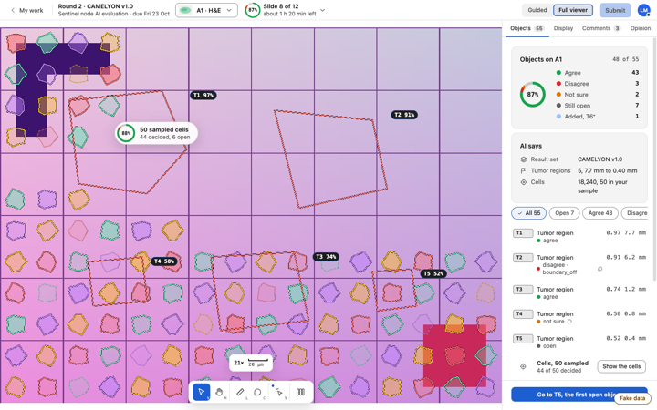
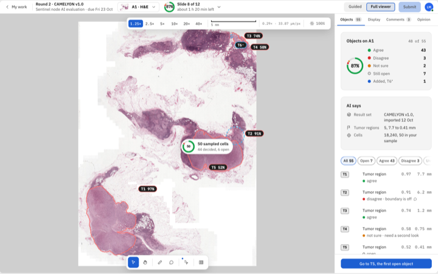
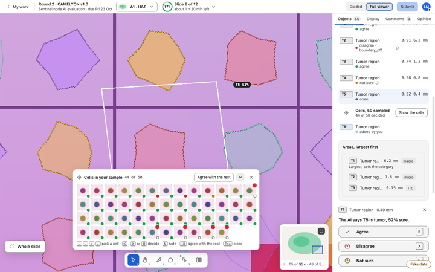
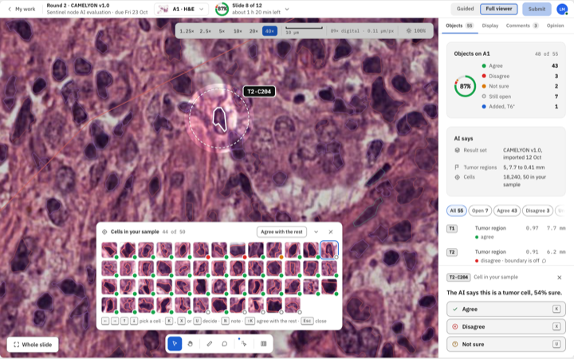
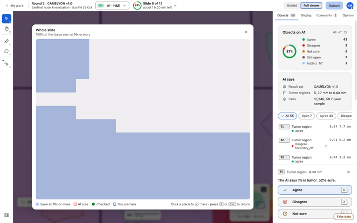
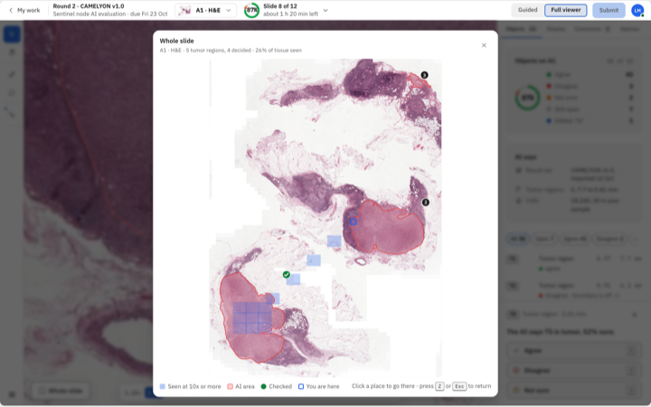
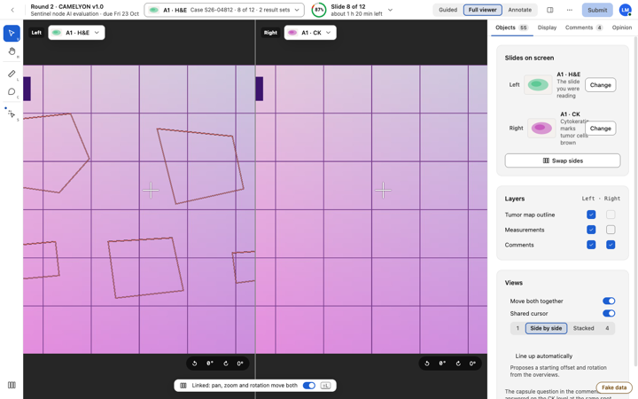
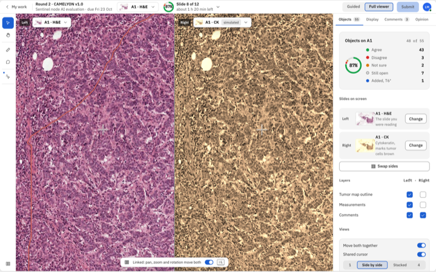
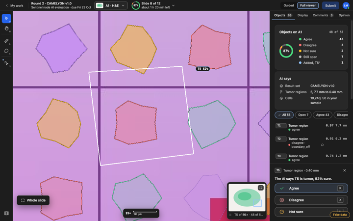
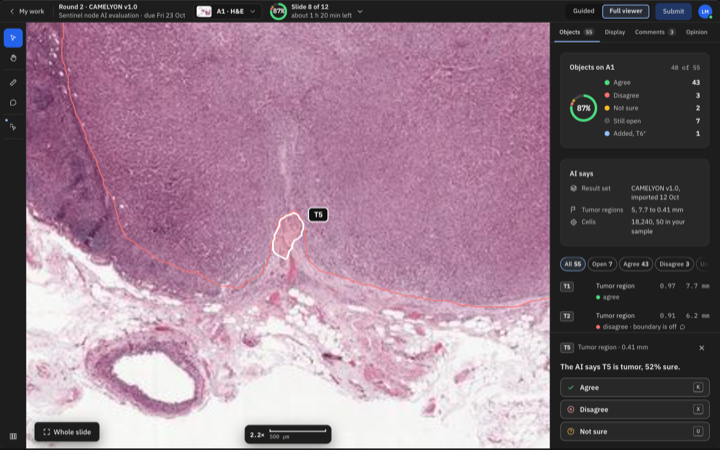

# Result: the viewer's drift from the frozen mock, second pass

- Date: 2026-11-19
- Backlog: PROTO-050 (a second drift audit covers the bottom dock, compare, peek, the shortcuts sheet and dark theme). Follows the first audit, [2026-11-18-viewer-mock-drift.md](2026-11-18-viewer-mock-drift.md), and the eleven tasks it proposed, PROTO-037 (the Objects tab) through PROTO-047 (annotate opens on Display)
- Kind: check
- Commit: 27da934d (the lead's head with the viewer work merged, not yet on `main`)
- Environment: MacBook, macOS 15, Chrome through Playwright, 1440x900 at scale 1, light and dark theme. The Mac was under load from other agents (load average 20 to 45), so nothing here is a timing
- Data: the fake API on port 5197, project `00000000-0000-4000-8003-000000000007`, slide A1 `…8005-000000000001`, review task RT-14 `…8007-000000000014`, viewed as Lenka Malá (`as=LM`). The mock's own fictional demo slide. No PHI

## Question

The first audit left five parts of the viewer uncompared: the bottom dock of tools (the Tools setting), compare slides, the whole slide peek, the shortcuts sheet and dark theme. Where does each differ from the frozen mock `docs/design/ux-mock/index.html`, how big is each fix, and does an accepted ADR justify keeping it? And of the first audit's 62 rows, which are fixed, partly fixed or still open at the lead's head?

## Method

1. Served the mock with `python3 -m http.server 7197` and the app with the fake API on port 5197.
2. The same kind of Playwright script as in the first audit wrote an outline of every visible control and text with its place, size, label, state and font. This time it also wrote the tone of each background, text and border as a lightness from 0 to 100, so dark theme could be compared by number. Mock places were taken relative to the mock's 1440x900 frame.
3. Mock scenes: `findings`, `case`, `annotate`, `guided`, `gallery`, `comments`, `measure`, `navigator`, `focus`, `layers`, `compare` (also with the picker open), `peek` and `shortcuts`, in light and dark, and the first seven again with the Layout switch on Bottom dock.
4. App screens: the full viewer in RT-14 on each of its four tabs, with T5 selected, with the cells panel open and with the tools S, L and C, guided review, the annotate workspace, the annotate task, the live viewer, focus mode, compare with and without the picker, the peek (Z), the shortcuts sheet (?), and the slides, progress and account popovers. All in light and dark. The viewer, annotate, guided, the cells panel and compare again with Tools set to Bottom dock in Settings.
5. `shot` times out on stage pages, so the script took Playwright screenshots and the comparison function of `@parfocal/golden-images` (the one `shot --against` uses, same loose tolerance) gave the share of differing pixels. Three app images were opened: the peek, the dock with the cells panel, and the dark viewer with T5 selected.
6. `docs/adr` was searched for each part. Only an Accepted ADR counts as a reason to keep a difference.

Not compared: anything that needs a drag on the slide, the developer drawer, the hold form of the Z key, the auto region bar with waiting proposals, and the issue states, which PROTO-048 (the viewer's issue states show the mock's cards) is building now.

## Results

### Numbers

The slide picture differs between the mock and the fake slide, so every number on a stage page is an upper bound, as in the first audit.

| Pair | Differing pixels | Mean error |
|---|---|---|
| App full viewer against mock `case`, light | 65.7% | 36.2 |
| App full viewer against mock `case`, dark | 67.1% | 66.1 |
| App guided review against mock `guided`, light | 67.3% | 40.1 |
| App guided review against mock `guided`, dark | 67.4% | 39.6 |
| App full viewer against mock `case`, bottom dock | 69.1% | 37.3 |
| App annotate against mock `annotate`, bottom dock | 72.3% | 55.7 |
| App cells panel against mock `gallery`, bottom dock | 70.2% | 60.0 |
| App compare against mock `compare`, light | 72.6% | 59.0 |
| App compare against mock `compare`, dark | 71.6% | 58.7 |
| App peek against mock `peek`, light | 72.9% | 85.0 |
| App peek against mock `peek`, dark | 55.2% | 58.3 |
| App shortcuts sheet against mock `shortcuts`, light | 46.3% | 35.7 |
| App shortcuts sheet against mock `shortcuts`, dark | 25.0% | 22.7 |

The first audit measured 71.9% for the full viewer and 73.7% for guided review. The shortcuts sheet is the only pair where the slide is mostly covered, and it is the closest.

| App | Mock |
|---|---|
|  |  |
|  |  |
|  |  |
|  |  |
|  |  |

### New differences

28 rows, numbered on from the first audit's 62. Places are in pixels of the 1440x900 frame. 24 are open and 4 are kept. One is size M.

#### Group K. Bottom dock (proposed task PROTO-E2)

| # | Where | Mock | App | Size | ADR that keeps it |
|---|---|---|---|---|---|
| 63 | Magnification bar with the dock | Moves to the top right of the slide, 12 px under the top bar and 12 px from the panel (914, 56). The dock has the bottom to itself | Stays at the bottom centre and is lifted above the dock (502, 778). The tool hint bar still drops to y 116 as in the mock, so the row at y 56 is empty | S | None. ADR 0338 (layout experiments split only unchosen production users) sets who gets the dock, not where the bar goes |
| 64 | Dock with the cells panel open | The panel sits at (241, 556) and the magnification bar stays in view at the top right | The panel sits at (241, 560), 618x268, and covers the magnification bar at y 778. The bar cannot be seen or used until the panel closes | S | None |
| 65 | Dock size | 271x48 with 36 px tools | 275x50 with 38 px tools | S | None |
| 66 | Dock on the compare screen | The "Linked" pill (y 852 to 884) lies on the dock (y 838 to 886). The mock overlaps itself here | The same overlap, pill at y 856 to 884 over the dock at y 836 to 886 | S | None. Lift the pill above the dock in the app, the mock is not a reason to keep an overlap |
| 67 | "Whole slide" button, both layouts | At the bottom left, level with the magnification bar (y 844) | 48 px higher (y 796), above the bar's row. Row 19 of the first audit is otherwise fixed | S | None |

The dock's place and centring, its groups and separators, "Compare slides" as its last button, the 635 px annotate dock with the same fourteen tools, no dock in guided review, the minimap at the bottom right and the cells panel's place all match.

#### Group L. Compare slides (proposed task PROTO-E3)

Compare is still drawn by the prototype frame (`screens/viewer-tools/compare-view.tsx` under a `scene` in the address), with an engine stage in each pane.

| # | Where | Mock | App | Size | ADR that keeps it |
|---|---|---|---|---|---|
| 68 | Top bar | The same bar as the viewer: "My work" (88 px), the title, a 138 px chip "A1 · H&E", progress at x 534, Guided and Full viewer | The older bar that PROTO-041 (the top bar's title, slide chip, decision ring and Submit match the mock) replaced in the viewer: a 32 px icon for back, a 362 px chip "A1 · H&E Case S26-04812 · 8 of 12 · 2 result sets", progress at x 699, a third choice Annotate, and extra "Side panel" and "More" buttons | S | None |
| 69 | Panel, head | The "Objects on A1" card with the ring stays above "Slides on screen" | Missing. The tab starts with "Slides on screen" | S | None |
| 70 | Panel, blocks | "Slides on screen", "Layers" and "Views" are 12 px labels over plain rows | Each is a card with a 14 px heading, 898 px in all | S | None |
| 71 | Panel, Views | No alignment control | "Line up automatically" with a status line | S | ADR 0271 (linked compare panes keep a per-pane offset) records CMP-006 (semi-automatic alignment). Kept |
| 72 | Panes | No rotation control, no crosshair | Rotate left, the angle, rotate right and reset (143x32) at the foot of each pane, and a crosshair at each centre | S | ADR 0271 records CMP-005 (rotation support) and CMP-003 (shared cursor). Kept |
| 73 | "Linked" pill | Text and the ⇧L key cap, 357x32 | The same with a switch added, 367x28 | S | None |
| 74 | Slide picker | "On the left now, picking it swaps the sides" | "On the left now, picking it swaps the panes", while the button beside it says "Swap sides" | S | None |
| 75 | Comments tab count | 3, as in the viewer | 4 on compare and 3 in the viewer for the same slide and task | S | None. A wrong number, not only a look |

The pane heads with Left and Right and their slide chips, the picker's place and width, "Change" and "Swap sides", the Layers toggles per side, the Views switches and the layout choice 1, Side by side, Stacked and 4 all match.

#### Group M. Whole slide peek (proposed task PROTO-E1)

| # | Where | Mock | App | Size | ADR that keeps it |
|---|---|---|---|---|---|
| 76 | What the overlay covers | Everything under the top bar, 1440x856, rail and panel included | Only the slide, 1048x856. The rail and the panel stay live beside it | S | None. ADR 0185 (smart minimap state machine and placement) sets the peek's states and keys only |
| 77 | Card and map | A 764x813 card with a 514x706 map in the slide's own proportions | An 894x748 card with an 864x648 box that does not follow the slide's proportions | S | None |
| 78 | Map content | The slide's picture, a tint where tissue was seen, the AI areas in red with their numbers, a mark on checked ones and a pulsing frame for the current view | Grey with blue blocks for seen tissue and nothing else. No slide picture, no AI areas, no checks and no frame, though the legend under it names all four | M | None |
| 79 | Subtitle | "A1 · H&E · 5 tumor regions, 4 decided · 26% of tissue seen" | "100% of the tissue seen at 10x or more" | S | None |
| 80 | Seen number | 26% in the peek, 21% in the progress popover | 100% in both straight after opening the task, while part of the peek's map has no tint | S | None. ADR 0234 (coverage is a per-person bitset) is only Proposed. A wrong number on the fake slide |

The title, the close button, the four legend labels, the hint "Click a place to go there · press Z or Esc to return", a tap on Z and Esc all match.

#### Group N. Shortcuts sheet (rows fold into PROTO-E5)

| # | Where | Mock | App | Size | ADR that keeps it |
|---|---|---|---|---|---|
| 81 | Zoom in | Key "=" | Key "+" | S | None |
| 82 | Foot of the section list | Nothing | A box "Who a setting applies to" with Personal, This computer and Set by your lab | S | ADR 0270 (settings schema, scopes and defaults) defines the three scopes the box explains. Kept |
| 83 | Rows | 107 lines of actions and hints | Every mock row plus 86 more lines for behaviour built since, such as "Zoom to the selection", "Back to the previous view", "Add a note" and a hint per tool | S | ADR 0155 (key registry, scopes and shadowing) makes the registry the list's source, and ADR 0277 (guided tour and help) makes this section the sheet. Kept |
| 84 | Cell keys hint | "in the cells panel" | "from the selected cell, to the nearest unsure one that way" | S | None |

The sheet opens with ? over the viewer as the Settings dialog, 960x720 at (240, 90), on the Shortcuts section, as the mock and ADR 0277 say. The nine sections, the search field, All, Changed and Conflicts, the preset, the legend, "Reset all", the group heads with their scope and the row layout match to within 8 px.

#### Group O. Dark theme (proposed task PROTO-E4)

Tones are lightness from 0 to 100 as the browser computed them.

| # | Where | Mock | App | Size | ADR that keeps it |
|---|---|---|---|---|---|
| 85 | Around the slide, every viewer screen | The canvas colour: 42, 42, 42 in dark and 207, 207, 207 in light | The chrome colour: 29, 29, 29 in dark and 255, 255, 255 in light, so in light the slide has no edge against the page | S | None |
| 86 | Around the slide in a compare pane | The same canvas colour per theme | 23, 23, 23 in both themes | S | None |
| 87 | Slide chip in the top bar | Quiet: tone 9 with a border of 22 | A button: tone 15 with a border of 44 | S | None |

Row 78 shows in dark as well. Nothing else differed. The chrome (11), cards (16 with a border of 20), tab counts (20 with text 80), text (93 and 80), faint text (73), the pressed tool (38), dialogs (11 with a border of 22), the settings list (16), status pills and the answer buttons carry the mock's tones on the full viewer's four tabs, guided review, annotate, the annotate task, the live viewer, focus mode, the cells panel, compare, the peek, the shortcuts sheet and the three top bar popovers. No surface larger than a 22 px badge stays light in dark theme. Minimap and slide thumbnails keep their own colours in both, as in the mock.

#### Group P. Found while rechecking (rows fold into PROTO-E5)

| # | Where | Mock | App | Size | ADR that keeps it |
|---|---|---|---|---|---|
| 88 | Guided review, Review tab | Ends with "Previous" and "Skip for now" | Also holds an "Areas, largest first" card, a "Measurements" card that says to press L though guided has no ruler, and a "Show the cells grid" button | S | None |
| 89 | Added object on the slide | T6⁺ carries a tag like the AI's regions | Five tags, T1 to T5. T6⁺ is in the list only | S | ADR 0398 (every viewer screen draws the slide through one engine stage) if T6⁺ has no outline in slide pixels on the fake slide. Not checked |
| 90 | Minimap foot | "T2 of 5" and "10× · 1 of 5 decided" side by side | The two texts overlap by 14 px and read "T5 of 95× · 48 of 5…" | S | None |

### The first audit's 62 rows at the lead's head

53 are fixed, 8 are partly fixed and 1 is still open.

| Rows | State | What is left |
|---|---|---|
| 1, 2, 5, 6, 7, 9 | Fixed | The summary card, "AI says", the cells row, "Go to T5, the first open object", the docked card with three stacked buttons and the 40 px cell crops are there |
| 3 | Partly fixed | The chips are there with counts, but the row runs past the panel's edge. "Disagree 3" is cut and Unsure and Added are out of sight |
| 4 | Partly fixed | Rows are 50 to 66 px with the decision line. The reason shows as the raw code "boundary_off" where the mock says "boundary is off", and T4's note is an icon without its text |
| 8 | Partly fixed | M1 joins the list (per `objects-tab-mock.spec.ts`, not run again). An "Areas, largest first" card still follows the list, and the mock has none in this tab |
| 10 to 16 | Fixed | Counts on the tabs, the panel's tones, no panel foot, Compare slides at the rail's foot, Select on open, "1.25×" and a 175 px bar, one line hint bars of 38 px |
| 17, 18, 20, 21 | Fixed | Five tags, one chip for the sampled cells, no result set chip on the slide, and a row click flies to the object |
| 19 | Partly fixed | The button is there and works. It sits 48 px too high (row 67) |
| 22, 23, 25 | Fixed | Hidden with the whole slide on screen, bottom right once zoomed in, and the guided inset "A1 · H&E · Click to move". The inset sits bottom right where the mock has top right, which ADR 0185 prefers |
| 24 | Partly fixed | The foot texts are there and overlap (row 90). The head "Whole slide · 21% seen" is missing |
| 26 to 33 | Fixed | Title, chip with thumbnail and stain, the decision ring with the time left, the two choice switch, Guided checked in guided, Submit disabled with "7 objects are still open.", the tooltip, and the popover counts 48 of 55 with the Added row |
| 34 | Partly fixed | "Parfocal home" is there. "Send feedback" is still an extra row |
| 35 to 38 | Fixed | The case head with "Open the case", both groups, the rows with result sets, progress bar and status, Q and E, and the three actions |
| 39 to 51 | Fixed | No rail, a 64 px top bar, the 469 px panel with Review, Comments and Display, the dots and the cells chip, the heading, three 58 px buttons, "Add something the AI missed", Previous and Skip, the read only chip, the three stage controls, the pan hint and the four tips. Row 47 (the slide done card) rests on PROTO-043's test and was not run again |
| 52 to 55 | Fixed | Preset, "How objects draw", "What the AI shows" with the result sets, and no map buttons in the tab |
| 56, 59 | Fixed | "Your decision notes" with four notes, and one row for the six open cells |
| 57 | Partly fixed | The button says "New comment on an ID". The Open and Resolved switch is still there |
| 58 | Partly fixed | A thread that was pinned on the slide opens beside its pin with the list kept (per `comments-notes-opinion.spec.ts`). A click on a seeded thread such as T2's moved the camera and opened nothing |
| 60 | Fixed | Annotate opens on Display |
| 61 | Fixed | By `annotate-display-auto-bar.spec.ts`, not run again. The bar showed the "Best" pill here |
| 62 | Still open | PROTO-048 (the viewer's issue states show the mock's cards) is in progress |

## Interpretation

The eleven tasks did what they claimed. The reviewer's loop now reads as in the mock, and what is left of the first audit is eight small ends and the issue states.

Of the five parts this pass added, dark theme and the shortcuts sheet are in good shape. Dark theme carries the mock's tones everywhere except the area around the slide. The shortcuts sheet differs in one key and one hint.

The bottom dock is laid out right but the magnification bar did not move with it, and with the cells panel open the bar disappears under the panel. Compare still runs on the prototype frame, so it kept the top bar the viewer dropped and counts comments differently. The peek is the weakest part: it draws a coverage grid and none of the slide, the AI areas, the checks or the current view that its own legend names.

## Proposed backlog tasks

IDs are placeholders for the lead to number. Order is by how much a reviewer would notice.

**PROTO-E1 · The whole slide peek shows the slide, the AI areas, the checks and where you are**

The peek on the engine viewer draws blue blocks for seen tissue on a grey box and nothing else, covers only the slide and says "100% of the tissue seen" while part of its map has no tint (rows 76 to 80 of the 2026-11-19 drift result). The mock's peek covers everything under the top bar and shows the slide's picture in its own proportions with the seen tint, the AI areas with their numbers, a mark on checked ones and a frame for the current view, under the subtitle "A1 · H&E · 5 tumor regions, 4 decided · 26% of tissue seen".
Draw those layers in `viewer/viewed-peek.tsx` from the stage's thumbnail, review objects and camera, size the map to the slide, cover the rail and the panel, and make the percentage in the peek and in the progress popover the share the map shows.
Done when a browser test on RT-14 taps Z, finds the slide picture, five numbered areas, a check on each decided one and the view frame, reads the subtitle with the regions and decided counts, clicks an area and lands on it, and the seen percentage equals the tinted share within one point.
Size: M.

**PROTO-E2 · The bottom dock moves the magnification bar to the top right and nothing overlaps it**

With Tools set to Bottom dock the tools sit where the mock has them, but the magnification bar stays at the bottom centre above the dock, the cells panel covers it, the "Linked" pill of compare lies on the dock, and the dock is 4 px wider and 2 px taller than the mock's (rows 63 to 66). The "Whole slide" button sits 48 px above the bar's row in both layouts (row 67).
In dock layout place the magnification bar 12 px under the top bar at the right edge of the slide as the mock does, lift the "Linked" pill above the dock, use 36 px tools, and put "Whole slide" level with the bar in the rail layout and at the bottom left in the dock layout.
Done when a browser test sets Bottom dock, finds the magnification bar at the top right in the viewer and in annotate, opens the cells panel and still clicks "10×", opens compare and finds no overlap between the pill and the dock, and reads the "Whole slide" button's place in both layouts.
Size: S.

**PROTO-E3 · Compare slides wears the viewer's top bar and the mock's panel**

Compare still draws the top bar that PROTO-041 (the top bar's title, slide chip, decision ring and Submit match the mock) replaced in the viewer, drops the "Objects on A1" card from the panel, wraps the three panel blocks in cards, says "panes" in the picker beside a "Swap sides" button, adds a switch to the "Linked" pill, and counts 4 comments where the viewer counts 3 (rows 68 to 70 and 73 to 75). Rotation, the crosshair and "Line up automatically" stay, as ADR 0271 (linked compare panes keep a per-pane offset) records them.
Draw compare under the engine viewer's top bar, keep the summary card above "Slides on screen", use the mock's plain section labels, say "sides" everywhere, match the pill, and feed the Comments count from the same threads as the viewer.
Done when a browser test opens compare from the rail on RT-14, reads "My work", the 138 px chip "A1 · H&E" and only Guided and Full viewer, finds "Objects on A1" above "Slides on screen", reads the same Comments count as in the viewer, and the compare specs still pass.
Size: S.

**PROTO-E4 · The area around the slide uses the canvas colour in both themes**

Around the slide the app paints the chrome colour, white in light and 29, 29, 29 in dark, where the mock paints its canvas colour, 207, 207, 207 and 42, 42, 42. Compare panes are 23, 23, 23 in both themes, and the slide chip in the top bar is drawn as a button where the mock's is quieter (rows 85 to 87).
Give the stage and the compare panes the canvas token of the theme, and the slide chip the mock's quiet tone and border.
Done when a browser test reads the stage background in light and dark on the viewer, guided review and compare and finds the canvas token each time, and the viewer golden images pass.
Size: S.

**PROTO-E5 · The last small ends of both drift audits are tied off**

Eight rows of the first audit are partly fixed and five small rows are new: the filter chips run past the panel, a reason shows as "boundary_off", an "Areas, largest first" card follows the object list and sits with a Measurements card and a "Show the cells grid" button in guided review, the minimap has no head and its foot texts overlap, "Send feedback" is an extra menu row, the Comments tab keeps an Open and Resolved switch, a seeded thread opens no popover, T6⁺ has no tag on the slide, zoom in shows "+" where the mock has "=", and the cell keys hint differs (rows 3, 4, 8, 24, 34, 57 and 58 of the first result and rows 81, 84 and 88 to 90 of this one).
Wrap the chips, print reasons in words, move or remove the Areas card and the guided extras, add the minimap's head and stop its foot from overlapping, open any thread at its object when it has no pin, tag added objects, and match the two shortcut rows. Record in `docs/decisions.md` whether "Send feedback" and the Open and Resolved switch stay.
Done when a browser test on RT-14 sees all six chips inside the panel, reads "boundary is off" on T2, finds no Areas card in guided review, reads the minimap's head and both foot texts without overlap, opens T2's seeded thread and sees its popover, and finds a T6⁺ tag on the slide.
Size: S.

Row 62 needs no new task, PROTO-048 already holds it.

## Follow-ups

- The fake slide's scale does not fit its objects: the viewer reads 95× on T5, a region 0.4 mm across, where the mock reads 2.2×. Magnifications were therefore not compared.
- Rows 47 and 61 and parts of rows 8 and 58 rest on the tests their tasks added. Those tests were not run again here.
- The peek was judged from one screenshot of the fake slide. Check row 78 on a real slide before sizing PROTO-E1.
- The outlines were not kept. The ten shots are in [2026-11-19-viewer-mock-drift-2](2026-11-19-viewer-mock-drift-2/).
